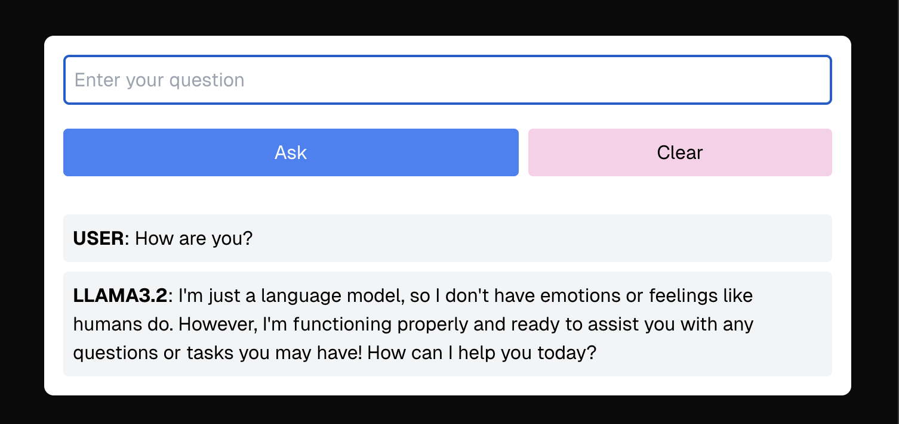
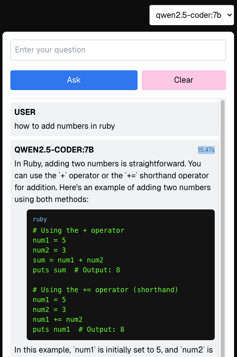

# ollama-next

### Talk to it with a chat model

  

### Ask it code questions with a code model

  

### Install

- Install the ollama cli
  - at 'https://ollama.com/download'
- Pull at least one of the models in the dropdown. You only need the ones you
  plan to select; the app does not download anything for you.
  - Chat models
    - `ollama pull qwen3.5:4b` [ ~3.4 GB, the default selection ]
    - `ollama pull qwen3.5:4b-mlx` [ ~4.0 GB, Apple-silicon MLX build ]
    - `ollama pull gemma4:26b-mlx` [ ~18 GB, needs 24+ gigs of VRam ]
    - `ollama pull qwen3.8:27b-mlx` [ ~18 GB, needs 24+ gigs of VRam ]
  - Code models
    - `ollama pull qwen2.5-coder:7b` [ ~4.7 GB ]
    - `ollama pull qwen3-coder-next:latest` [ ~51 GB, needs 64+ gigs of VRam ]
- Run the ollama model server
  - `ollama serve`
- Run the ollama-next model ui
  - `pnpm install`
  - `pnpm run dev`

### Other useful commands

- `ollama list` - see which models you have pulled
- `ollama ps` - see which models are currently loaded in memory
- `ollama run qwen3.5:4b`
- `ollama stop qwen3.5:4b`

### How it works

- You install and run the ollama server
- You pull the models you want to use
  - The dropdown in the top right picks which one each request goes to
  - The selectable list lives in src/hooks/useModels.ts - keep it in sync with
    your own `ollama list`
  - See src/server/trpc/router.ts where the selected model is ran and queried
- The ui is an interface to chat with the model
- It "remembers" the last 7 or so things you asked about to simulate memory
